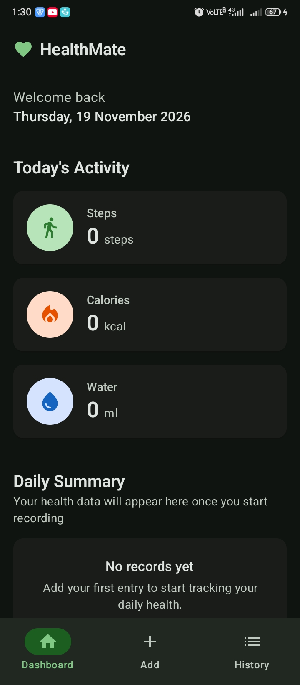
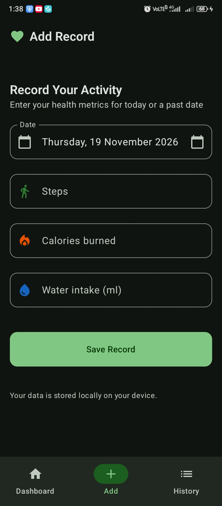
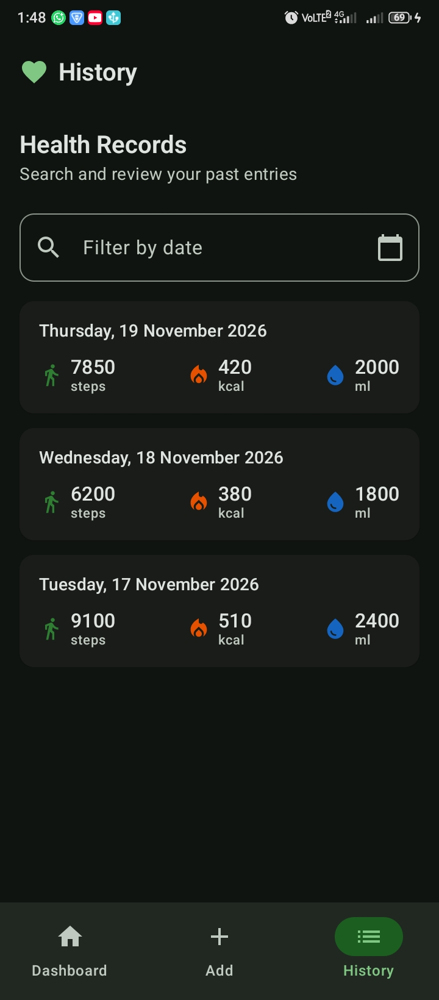

# HealthMate – Personal Health & Wellness Tracker

Native Android application built with Kotlin and Jetpack Compose for daily health tracking (steps, calories, water intake).

## Coursework

- **Module:** Mobile Application Development
- **Programme:** BSc (Hons) Software Engineering (Top-up)
- **Institution:** Kingston University / ESU
- **Assessment:** Coursework 1 (50%)

## Technology Stack

| Component | Technology |
|---|---|
| Language | Kotlin 2.3.20 |
| UI | Jetpack Compose + Material 3 |
| Architecture | MVVM + Clean Architecture (3 layers) |
| State Management | ViewModel + StateFlow |
| Navigation | Navigation 3 (type-safe `NavKey` routes) |
| Database | Native SQLite via `SQLiteOpenHelper` |
| Build | Gradle 9.1.0 (wrapper) |
| AGP | 9.0.1 |
| minSdk / targetSdk | 26 / 36 |
| IDE | VS Code (with Gradle CLI + ADB deployment) |

## Project Status

- **Completed**: Development environment and project setup
- **Completed**: UI foundation and navigation (design system, components, 3 screens)
- **Pending**: SQLite database and seeding
- **Pending**: Repository, CRUD, dashboard data, goals, statistics, testing, release

## Module 02 Screenshots

| Dashboard | Add Record | History |
|---|---|---|
|  |  |  |

## Build and Run

### Prerequisites
- JDK 17
- Android SDK (API 36, build-tools 36.0.0)
- `ANDROID_HOME` and `JAVA_HOME` set
- Physical Android device (API 26+) with USB debugging enabled

### Build
```bash
./gradlew assembleDebug